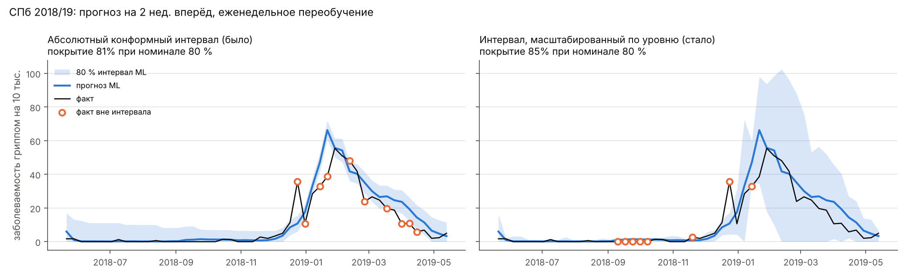
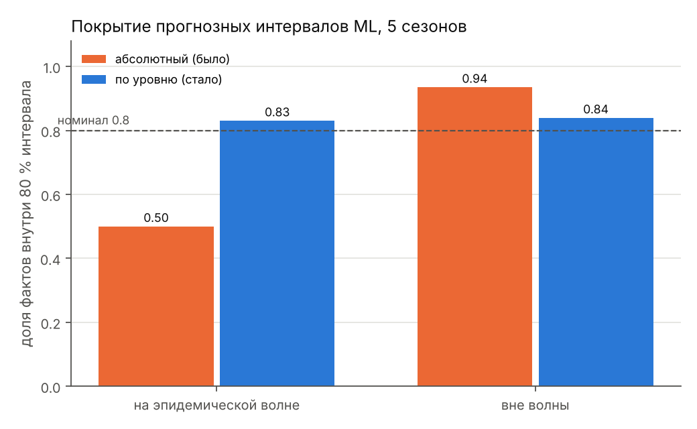
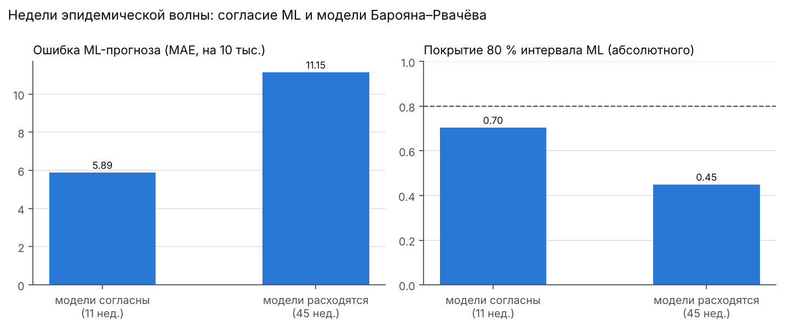
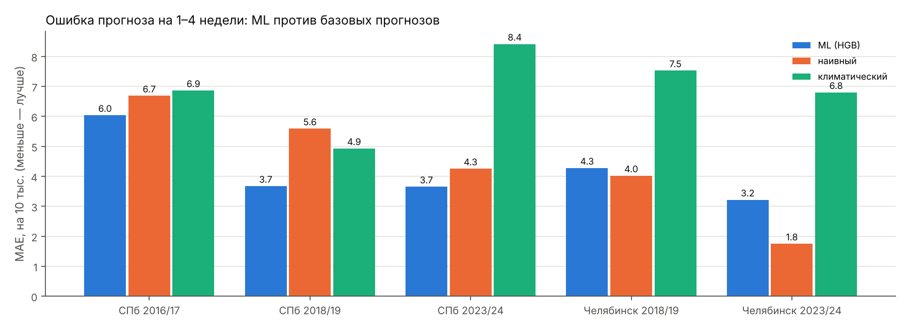
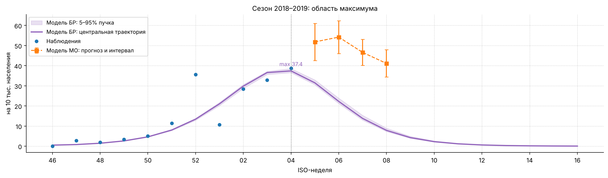
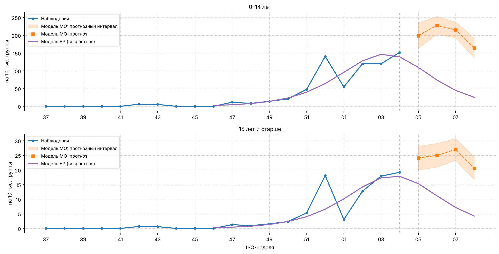

# Скользящий бэктест и контроль качества данных

## Что сделано

1. **Контроль качества данных** (`ai4epi.analysis.data_quality`, блок `data_quality` в каждом запуске
   анализа):
   - доля недель без данных ПЦР (восстановлены интерполяцией) в обучении, проверке и последних 8 неделях;
   - новогодние недели (ISO 52, 53, 1) среди текущей недели и горизонтов;
   - метрики основной ML-модели против наивного прогноза («как на текущей неделе») и климатического
     (среднее той же ISO-недели в прошлых сезонах) на тех же проверочных точках, skill = 1 − MAE модели /
     MAE базового прогноза;
   - итог `reliability_code` = `ok` / `reduced` / `low` с причинами; расхождение ML и модели
     Барояна–Рвачёва тоже понижает надёжность (`models_disagree`, см. результаты ниже);
   - секции «Прогноз и оценка рисков» и «Качество модели» получают надёжность и причины, а runtime-правило
     `low_reliability_disclosed` требует, чтобы текст о них сообщал (при `low` — ошибка, при `reduced` —
     предупреждение).
2. **Скользящий бэктест** (`ai4epi.analysis.backtest`, команда `ai4epi backtest-local`) — процедура
   статьи: на каждой неделе периода
   - ряд берётся «как известно на эту неделю» (пропуски ПЦР обрабатываются только по данным до неё — для
     этого исправлен загрузчик: раньше `--end-date` обрезал ряд *после* интерполяции, и восстановленные
     значения последних недель использовали данные ПЦР из будущего);
   - HGB переобучается для каждого горизонта 1–4 недели;
   - конформный 80 % интервал — по ошибкам предыдущих недель, цели которых уже известны (последние 104;
     52 недели разогрева перед периодом в метрики не входят); считаются два вида: абсолютный (как в
     продукте) и масштабированный по текущему уровню (`|e| / (y_t + 1)`);
   - модель Барояна–Рвачёва (MCMC, настройки статьи) перекалибровывается, фиксируются фаза, значения на
     горизонтах и код согласия с ML.

```bash
ai4epi backtest-local --city spb --start 2018-05-07 --end 2019-04-29 --legacy-variant --output-dir runs/backtest_spb_2018
```

Результат: `predictions.csv` (по строке на неделю × горизонт), `metrics.json`, `report.md`. Время на
4 ядрах: 2–6 мин на сезон (52 + 52 недели разогрева).

> **Что изменено в продукте по итогам бэктеста:** конформные интервалы ML по умолчанию масштабируются по
> текущему уровню (`ForecastingConfig.interval_scaling="level"`, исходный вариант — `"absolute"`), а HGB
> обучается в быстром режиме (`learning_rate` 0.03, 300 итераций; исходный — `legacy_point_config()`).
> Полный анализ одной недели — 5 с вместо 45 с. Цифры ниже получены до переключения: колонка «ML» —
> исходный HGB, «быстрый вариант» — нынешний режим по умолчанию.

## Графики









Пример отчётных рисунков (СПб, 21.01.2019): модель Барояна–Рвачёва и ML-прогноз; прогноз по возрастным группам.





Графики воспроизводятся командой `python scripts/plot_backtest_figures.py <каталог бэктестов> docs/figures`.

## Результаты: 5 сезонов, 52 недели каждый (май – апрель), без погодных признаков

### Точность ML по сезонам (все горизонты, 208 точек на сезон)

| Сезон | R² ML | R² наивный | MAE ML | MAE наивный | MAE климат. | покрытие 80 % интервала |
|---|---|---|---|---|---|---|
| СПб 2016/17 | 0.624 | 0.525 | 6.04 | 6.69 | 6.86 | 0.79 |
| СПб 2018/19 | 0.812 | 0.575 | 3.67 | 5.59 | 4.93 | 0.81 |
| СПб 2023/24 | 0.425 | 0.010 | 3.65 | 4.25 | 8.42 | 0.84 |
| Челябинск 2018/19* | −3.68 | −9.64 | 4.28 | 4.02 | 7.53 | 0.79 |
| Челябинск 2023/24* | −1.63 | 0.163 | 3.22 | 1.75 | 6.80 | 0.85 |

\* В Челябинске на дату отчёта данных ПЦР нет в 33 из 52 (2018/19) и в 19 из 53 (2023/24) недель —
в эти недели бюллетень по гриппу выпустить нельзя, они не оценивались (n = 76 и 136 точек).

- В СПб ML устойчиво лучше наивного и климатического прогнозов (в статье для СПб с температурой —
  R² = 0.736 на 2025/26; здесь 0.43–0.81 без погоды).
- В Челябинске 2023/24 ML хуже наивного прогноза (MAE 3.22 против 1.75) — именно этот случай теперь
  ловит блок `data_quality` (на 15.01.2024: надёжность «низкая»: 5 из 8 последних недель без ПЦР,
  выигрыш у наивного прогноза 8 %, модели расходятся).
- Быстрый вариант HGB (`learning_rate` 0.03, 300 итераций; обучение в ~20 раз быстрее) по точности
  не уступает текущему (R² 0.802 / 0.438 / 0.620 против 0.812 / 0.425 / 0.624 в СПб).

### По фазам волны (все сезоны, MAE на всех горизонтах)

| Фаза (по модели БР) | недель | ML | наивный | модель БР |
|---|---|---|---|---|
| рост | 9 | **15.4** | 18.6 | 30.0 |
| максимум | 14 | **9.1** | 16.2 | 15.7 |
| спад | 33 | 9.1 | **7.7** | 10.0 |
| волна завершилась | 96 | **1.35** | 1.46 | 2.03 |
| волна не выявлена | 58 | **3.34** | 3.62 | — |

ML лучше всего на росте и максимуме; на спаде наивный прогноз точнее ML (в статье — ML «предсказывает
стабилизацию на ненулевом уровне» на спаде; здесь та же картина). Модель БР как источник *значений* на
1–4 недели проигрывает ML во всех фазах, кроме отдельных сезонов на спаде (Челябинск: MAE 2.4 и 3.7
против 14.4 и 9.3 у ML) — это согласуется с ролью, которую ей отводит статья (фаза и максимум, а не
количественный прогноз).

### Правило согласия моделей

Первая версия правила почти всегда выдавала «расхождение» (27 из 36 и 39 из 40 недель в СПб): после
завершения волны при значениях около 1 на 10 тыс. порог «50 % относительной разницы» превышается от
шума. Исправлено: (1) после завершения волны согласие не оценивается — по шагу 7 схемы статьи модель БР
тогда не используется; (2) относительная разница считается к `max(|ML|, 5 на 10 тыс.)`. Варианты
сравнивались на сохранённых прогнозах первых прогонов; итог — на повторном прогоне с окончательным кодом:

| Код (недели волны, все сезоны) | недель | MAE ML | MAE БР | покрытие 80 % интервала ML |
|---|---|---|---|---|
| согласие | 11 | **5.89** | 6.52 | 0.70 |
| расхождение | 45 | 11.15 | 16.59 | 0.45 |

При расхождении ошибка ML почти вдвое выше, а его интервал покрывает факт лишь в 45 % случаев — это
подтверждает тезис статьи («расхождение — признак повышенной неопределённости») на независимых сезонах;
поэтому `models_disagree` понижает надёжность в `data_quality`. Ограничение: 56 недель волны в 5 сезонах
двух городов; пороги стоит перепроверять на новых сезонах.

### Прогнозные интервалы по фазам

| Вид интервала | покрытие на волне | вне волны | всего | ширина на волне | вне волны |
|---|---|---|---|---|---|
| абсолютный (как в продукте) | **0.50** | 0.94 | 0.82 | 16.9 | 11.0 |
| масштабированный по уровню | 0.83 | 0.84 | 0.84 | 59.9 | 7.1 |

Текущие конформные интервалы откалиброваны «в среднем за год», но во время волны покрывают факт лишь в
половине случаев (и избыточно широки в межсезонье). Интервалы, масштабированные по текущему уровню,
держат номинальное покрытие в обеих фазах. **Включено в продукте** (`interval_scaling="level"`): на пике
интервалы заметно шире (СПб, 21.01.2019, прогноз на 4 недели: 41 при интервале 0–109), вне волны — уже.

## Ограничения бэктеста

- Нет версий данных: «как известно на дату» учитывает только наличие ПЦР, но не пересмотры ОРВИ и
  численности населения; фактические значения — из последней выгрузки.
- Без погодных признаков (нет доступа к Open-Meteo из этого окружения).
- Модель БР — общий ряд; возрастные модели в бэктест пока не включены.

## Статистические базовые прогнозы: ARIMA с гармониками и ETS

`ai4epi.analysis.baselines`: ARIMA(2, 0, 1) на log(1 + y) с тремя парами гармоник годового цикла
(«динамическая гармоническая регрессия») и ETS (Холт–Уинтерс, затухающий тренд, годовая сезонность) на
log(1 + y). Обе модели переобучаются на каждой дате прогноза по последним 6 годам, ~0.2 с на дату. Они
считаются в бэктесте (столбцы `harmonic_arima`, `ets`) и в блоке качества данных: если ML на проверочном
периоде не точнее хотя бы одной из них, надёжность прогноза понижается (`not_better_than_statistical`).

Бэктест ML и базовых прогнозов: 25 сезонов 8 городов (октябрь–апрель), 2808 прогнозов, горизонты 1–4 недели.

| Прогноз | MAE, все недели | h1 | h2 | h3 | h4 | недели с заболеваемостью ≥ 5 на 10 тыс. |
|---|---|---|---|---|---|---|
| ML (HGB) | 7.51 | 6.29 | 7.41 | 7.96 | 8.36 | **11.97** |
| ARIMA с гармониками | **6.94** | **5.29** | **6.65** | **7.62** | **8.18** | 12.19 |
| наивный («как на этой неделе») | 8.06 | 5.47 | 7.30 | 8.88 | 10.60 | 14.07 |
| климатический (среднее той же недели) | 10.19 | 10.18 | 10.20 | 10.14 | 10.23 | 13.83 |
| ETS | 10.30 | 6.46 | 8.99 | 11.67 | 14.07 | 19.04 |

По городам (средняя MAE по сезонам, ML / ARIMA): Краснодар 3.11 / 3.51, Новосибирск 7.99 / 8.53, СПб 7.93 / 8.09 —
ML лучше или наравне; Челябинск 9.20 / 8.11, Москва 7.68 / 6.85, Омск 7.11 / 5.16, Самара 7.69 / 6.41,
Воронеж 6.90 / 4.86 — лучше ARIMA. ML точнее ARIMA в 9 сезонах из 25; ARIMA точнее наивного прогноза в 20 из 25.

**Выводы.** Простая модель временного ряда с годовым циклом не хуже ML-модели: в целом точнее на всех горизонтах,
особенно на 1–2 недели, где ML даже уступает наивному прогнозу. Преимущество ML — только на неделях высокой
заболеваемости (11.97 против 12.19, разница 2 %) и в городах с длинными чистыми рядами (СПб, Новосибирск).
ETS с годовой сезонностью на этих рядах плох: сезонный компонент «размазывает» волны разных лет, а затухающий
тренд на 3–4 недели уводит прогноз далеко.

### ARIMA как признак ML-модели и среднее двух прогнозов

Те же 25 сезонов, 2812 прогнозов (MAE):

| Прогноз | все | h1 | h2 | h3 | h4 | недели ≥ 5 на 10 тыс. |
|---|---|---|---|---|---|---|
| ML | 7.50 | 6.29 | 7.40 | 7.96 | 8.35 | 11.95 |
| ML + прогнозы ARIMA как признаки (`arima_features=True`) | 7.44 | 6.40 | 7.36 | 7.94 | 8.07 | 11.93 |
| ARIMA с гармониками | 6.94 | **5.29** | **6.65** | 7.62 | 8.18 | 12.17 |
| **среднее ML и ARIMA** | **6.78** | 5.38 | **6.65** | **7.37** | **7.72** | **11.19** |

Признаки ARIMA почти не помогают ML (−0.8 %, лучше в 11 сезонах из 25): деревья с минимальным листом 95 строк
мало что добавляют к лагам. Простое среднее ML и ARIMA лучше обеих моделей — в целом, на горизонтах 3–4
недели и на неделях высокой заболеваемости (−6 % к ML на волне); лучше ML в 20 сезонах из 25, лучше ARIMA — в 15.
Ошибки двух моделей разной природы частично компенсируются. Признаки ARIMA оставлены опцией (по умолчанию
выключены); среднее пока не встроено в прогноз бюллетеня.

Все результаты — без погодных признаков (Open-Meteo из окружения разработки недоступна); с температурой
(`scripts/convert_weather_export.py`, `--weather-weekly`) сравнение нужно повторить.

### С температурой (СПб)

Недельная погода — метеостанция Санкт-Петербург (WMO 26063, архив rp5.ru, `data/weather/spb_weekly.csv`).
8 сезонов СПб (2014/15–2019/20, 2022/23, 2023/24), 972 прогноза, MAE:

| Прогноз | все | h1 | h4 | недели ≥ 5 на 10 тыс. |
|---|---|---|---|---|
| ML без температуры | 7.88 | 6.14 | 9.05 | 11.32 |
| ML с температурой | 7.57 | 6.34 | 8.73 | 10.79 |
| ARIMA с гармониками | 8.04 | 5.96 | 9.78 | 11.87 |
| среднее ML и ARIMA | 7.44 | **5.62** | 8.85 | 10.75 |
| **среднее ML с температурой и ARIMA** | **7.31** | 5.70 | **8.74** | **10.53** |

Температура улучшает ML на 4 % в целом и на 5 % на неделях волны (лучше в 5 сезонах из 8), на горизонте 1
неделя — нет. В СПб ML и без температуры не хуже ARIMA; лучший вариант по-прежнему — среднее ML и ARIMA.
Проверить, меняет ли температура расклад там, где ARIMA сильнее (Москва, Омск, Самара, Воронеж, Челябинск),
можно только с погодой для этих городов.

### С температурой (Москва)

Недельная погода — аэропорт Шереметьево (METAR UUEE, архив rp5.ru, `data/weather/moscow_weekly.csv`, с 24.09.2012;
ВДНХ в rp5 не выгружается). 6 сезонов Москвы (2014/15–2019/20, октябрь – апрель), 668 прогнозов — только точки,
где оба варианта ML построены (в 2014/15 с погодой обучение начинается с декабря: погода есть лишь с осени 2012).
MAE:

| Прогноз | все | без 2015/16 | h1 | h4 | ср. отношение к ARIMA по сезонам |
|---|---|---|---|---|---|
| наивный (persistence) | 11.35 | 7.47 | **7.94** | 14.37 | 1.25 |
| **ARIMA с гармониками** | **9.99** | **5.93** | 8.12 | 11.31 | **1.00** |
| ML без температуры | 12.11 | 7.86 | 10.81 | 12.85 | 1.47 |
| ML с температурой | 11.42 | 7.48 | 10.47 | 12.13 | 1.33 |
| среднее ML и ARIMA | 10.33 | 6.25 | 8.78 | 11.16 | 1.13 |
| среднее ML с температурой и ARIMA | 10.18 | 6.18 | 8.71 | **11.07** | 1.07 |

Температура улучшает ML и в Москве (−6 % MAE, лучше в 4 сезонах из 6), но расклад не меняет: ML и с
температурой хуже ARIMA в 5 сезонах из 6. ARIMA лучшая из всех прогнозов в 2014/15, 2017/18 и 2018/19;
среднее ML и ARIMA — в 2016/17 и 2019/20, среднее с температурой — в 2015/16 и на горизонте 4 недели.
2015/16 (крупная волна
A(H1N1)pdm09) даёт около трети суммарной ошибки, все модели ошибаются на нём одинаково (MAE 29–32).
