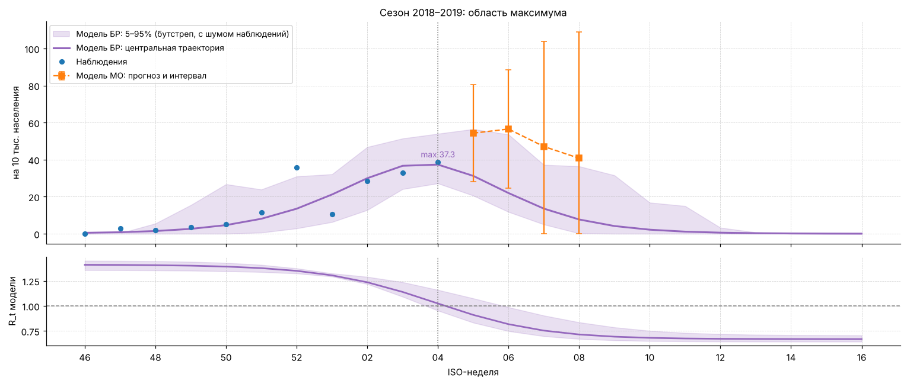

# Модель Барояна–Рвачёва в AI4Epi

Этот документ описывает, как код `Influenza_bulletin` (vnleonenko/Influenza_bulletin, коммит
`6f406cc`) встроен в AI4Epi, чем перенос отличается от исходного кода и что проверено.
Возрастная модель и ML-прогноз по возрастным группам описаны в [age_groups.md](age_groups.md).

## Место в системе

Схема комплементарного применения моделей из статьи Лазутова и др. («Комплементарное применение
моделей машинного обучения и механистической модели для краткосрочного прогнозирования
заболеваемости гриппом»):

| Шаг схемы | Где в AI4Epi |
|---|---|
| 1. Еженедельный бюллетень → `y_t` | `ai4epi.data.influenza` (API) или `ai4epi.data.local_excel` (xlsx) |
| 2. ML-прогноз на 1–4 недели с интервалами | `ai4epi.analysis.forecasting` (HGB + конформные интервалы) |
| 3. Идёт ли эпидемическая волна? | `mechanistic_wave.detect_wave` — нет: блок не создаётся, вывод только по ML |
| 4. Модель БР: фаза, максимум, завершение | `mechanistic_wave.run_mechanistic_wave_analysis` |
| 5. Прогнозы согласуются? | `comparison_with_ml.agreement_code` |
| 6а/6б. Совместный вывод / повышенная неопределённость | секция `mechanistic_wave` (narrator по `MECHANISTIC_WAVE_PROMPT`) |

Этап включается флагом `--mechanistic-wave` (CLI) или `AnalysisPipelineSettings(run_mechanistic_wave=True)`.
По умолчанию он выключен: нужны зависимости `pip install -e ".[mechanistic]"` (PyMC 5.x), а MCMC
добавляет несколько секунд на одну неделю отчёта.

## Что куда перенесено

| Influenza_bulletin | AI4Epi | Комментарий |
|---|---|---|
| `model_complex/models/*` | `ai4epi/mechanistic/models.py` | общая модель — разностная схема без изменений (тест `test_total_model_matches_legacy_loop`); возрастная модель исправлена, см. [age_groups.md](age_groups.md) |
| `model_complex/calibration/Algorithms/*`, `Calibration.py` | `ai4epi/mechanistic/calibration.py` | одна функция `calibrate(...)` вместо классов, возвращает `CalibrationResult` |
| `model_complex/calibration/Forecast.py`, `plot_module/*` | `analysis/mechanistic_wave.build_trajectories`, `output/figures._plot_mechanistic_wave` | пучок траекторий → квантили 5/50/95 %, рисунок «Рис. 5» в бюллетене |
| `model_complex/epid_data/epid_data.py` (xlsx) | `ai4epi/data/local_excel.py` | приводит xlsx к тому же контракту `cases`, что и API |
| `model_complex/epid_data/influenza_data.py` (API) | уже был в `ai4epi/data/influenza.py` | — |
| `data/{spb,samara,chelyabinsk}` | `data/regions/...` | — |
| `data/samara_day` | не перенесён | это недельный ряд Самары с датами, переписанными в последовательные дни (2010-04-01 … 2012-05-13); тестовые данные для режима `day`, не реальные суточные |
| `prediction_module/predictor.py` (перебор ε) | не перенесён | ε — параметр `MechanisticWaveConfig.epsilon` / `--br-epsilon` |
| `get_predictions.ipynb`, `test.ipynb` | не перенесены | исходный код целиком — в репозитории vnleonenko/Influenza_bulletin и в истории RapidVasiliy/SberAuto (коммит `23bafa0`) |

## Параметры по умолчанию (`MechanisticWaveConfig`)

| Параметр | Значение | Источник |
|---|---|---|
| профиль заразности `g` | (0.1, 0.1, 1, 0.9, 0.55, 0.3, 0.15, 0.05) | статья, исходный код |
| `underreporting_kappa` | 0.1 (эффективная популяция N/10) | статья, исходный код (`get_rho() // 10`) |
| `initial_infectious` | 100 | статья, исходный код |
| `method` | `mcmc`: `pm.Simulator` + DEMetropolisZ, 4 цепи × (2500 + 500) | статья, приложение |
| `observation_scale`, `epsilon` | `per_10k`, 1.0 | статья: ядро (abc) по `y_w` на 10 тыс., ε = 1 |
| `n_trajectories` | 200 | статья |
| `calibration_start` | `wave_onset`: начало роста минус 2 недели | статья: «вблизи начала текущей волны» |
| `season_start_week` | 35 | статья (рисунки для РФ — с 35-й недели) |
| порог волны | ≥ 1 случая на 10 тыс. и 3 недели роста подряд | новое; в статье — «эпидемический порог или рост несколько недель подряд» |
| завершение волны | первая неделя после максимума, где центральная траектория < 10 % максимума | новое, настраивается (`wave_end_fraction`) |
| согласие моделей | одинаковое направление (порог ±10 %) от текущей недели к h=4 и средний относительный разрыв ≤ 50 % | новое, настраивается |

## Отличия от исходного кода и почему

1. **Шкала невязки (ε).** Исходный код сравнивал модель с данными в абсолютных числах случаев
   (ε по умолчанию 3000/10000, в бюллетене перебор 10…70). В статье ядро записано для
   заболеваемости на 10 тыс., ε = 1. По умолчанию сделано как в статье; `observation_scale="cases"`
   воспроизводит исходный код. На данных СПб 2018/19 при ε = 1 в абсолютных числах R-hat = 4.7
   (цепи не сходятся), на шкале «на 10 тыс.» — 1.06.
2. **Пары параметров.** Исходный код выбирал α и β для пучка независимо из маргинальных
   распределений и тем самым разрушал их сильную корреляцию. Теперь берутся пары из совместной
   апостериорной выборки (как сказано в статье).
3. **Начало калибровки.** Исходный код и рисунки статьи калибровали с фиксированной недели. Так как модель
   стартует со 100 заражённых в первую неделю интервала, ранний старт жёстко задаёт сроки волны.
   На СПб, 11.03.2019: старт с 35-й недели даёт R² = 0.27 и пик 14.01 на уровне 18; старт от начала
   роста — R² = 0.80 и пик 04.02 на уровне 56 (фактически 28.01, 55.5). Режим статьи —
   `--br-calibration-start season_start`.
4. **Порядок недель.** Ряд всегда сортируется по дате (исходный код не сортировал; при ответе API по
   убыванию даты шаг определялся как «сутки»).
5. **Подписи недель.** Номера ISO-недель берутся из дат, а не из `begin_week + k` с вычитанием 52, поэтому
   53-недельные годы (2020, 2026) не сдвигают ось.
6. **Воспроизводимость и диагностика.** `random_seed` для MCMC/SMC/Optuna/annealing; R-hat и ESS
   попадают в контекст (`diagnostics`) и в предупреждения анализа.
7. **Не выполняется** `sample_posterior_predictive`: в исходном коде его результат не использовался.
8. **Пропуски ПЦР в локальных данных.** В xlsx Самары и Челябинска около трети недель без данных
   ПЦР; исходный код (и `weekly_incidence_from_cases`) превращал их в нулевую заболеваемость гриппом,
   из-за чего ряд «пилил» (Челябинск, декабрь 2022: 57 → 0 → 108 → 0). По умолчанию доля
   положительных проб по штаммам интерполируется, недели помечаются `pcr_imputed`, этап модели БР
   предупреждает об импутированных неделях в окне калибровки. Исходное поведение:
   `--pcr-gap-policy zero`. Недели без ПЦР в конце выгрузки отбрасываются в обоих режимах.

## Бутстреп и R_t (из RSCF_Uncertainty)

`--br-method bootstrap` (`calibrate(method="bootstrap")`) — параметрический бутстреп, как в
`BaroyanAgeMultistrain_v2/bootstrapping`:

1. точечная оценка — минимум суммы квадратов невязки (`dual_annealing`);
2. дисперсия шума — по остаткам калибровки (для каждой группы своя);
3. `bootstrap_replicates` (100) синтетических рядов «модель + отрицательно-биномиальный шум» с этой
   дисперсией, на каждом — перекалибровка (Нелдер–Мид от точечной оценки);
4. пучок траекторий — кривые перекалиброванных параметров; полоса q05–q95 по умолчанию
   **предсказательная** (`bootstrap_band="predictive"`: к кривым добавлен тот же шум наблюдений), то есть
   относится к будущим наблюдениям, а не только к кривой модели.

**R_t.** Для каждой траектории считается эффективное репродуктивное число: матрица следующего
поколения `K_t[j,i] = S^j_t · B[j,i] · Σg / ρ`, R_t — её спектральный радиус (для общей модели
`R_t = β · S_t · Σg / ρ`). В контексте — блок `reproduction_number` (значение на последней наблюдаемой
неделе, диапазон по пучку, максимум, неделя перехода через 1), в отчёте — нижняя панель рис. 5. Это
величина модели (без учёта насыщения `min(·, S)`), а не измерение; секция обязана так её и называть.



СПб, состояние на 21.01.2019, `--br-method bootstrap`: R_t = 1.02 (0.95–1.16), по модели ниже 1 с 4-й недели;
максимум 37 на 10 тыс. (диапазон 34–56; фактически 28.01, 55.5).

**Проверка на бэктесте** (СПб, `ai4epi backtest-local --br-method ...`, прогноз на 1–4 недели, только недели,
где модель БР откалибрована; номинальное покрытие полосы 0.9):

| Сезон | Метод | покрытие полосы БР | на волне | средняя ширина, на 10 тыс. | MAE БР: рост / пик / спад |
|---|---|---|---|---|---|
| 2018/19 | MCMC (ε = 1) | 0.06 | 0.09 | 4.0 | 29.3 / 15.8 / 11.4 |
| 2018/19 | бутстреп | 0.54 | 0.75 | 25.7 | 26.7 / 15.2 / 10.6 |
| 2023/24 | MCMC (ε = 1) | 0.05 | 0.14 | 4.0 | 31.2 / 13.6 / 1.2 |
| 2023/24 | бутстреп | 0.35 | 0.53 | 10.9 | 29.5 / 18.4 / 1.3 |

Бутстреп на порядок честнее описывает неопределённость (полоса MCMC с ε = 1 почти никогда не накрывает
будущие наблюдения), точность центральной траектории та же. Но и он недопокрывает, особенно на горизонте
3–4 недели (0.45–0.50 и 0.26–0.30): шум оценивается по остаткам уже наблюдаемой части волны и не
учитывает структурную ошибку модели (одна волна, праздничный провал 1-й недели, вторичный подъём). Поэтому
по умолчанию оставлен метод статьи (`mcmc`), а бутстреп — опция; для количественного прогноза
по-прежнему используется ML-модель.

## Известные ограничения

* **Сходимость MCMC.** С настройками статьи (4 × 500) R-hat часто 1.1–1.9, ESS < 100; при ε = 1 апостериорное
  распределение узкое, и пучок траекторий почти не отражает неопределённость структуры модели.
  Это видно в `diagnostics`; секция обязана сообщать о неустойчивости, если `converged=false`.
* **α у верхней границы.** В сезонах с большой волной (СПб 2018/19 при старте с 35-й недели) оценка α
  упирается в 1: при κ = 0.1 модель не может описать заболевших больше 10 % населения. Флаг
  `parameters.alpha_at_upper_bound`.
* **Одна волна.** Модель описывает одну волну; вторичный подъём (Челябинск, январь 2023) она не
  воспроизводит — это и есть случай «расхождения» по схеме статьи.
* **Возрастная модель** исправлена и подключается флагом `--br-age-groups`; её ограничения — в
  [age_groups.md](age_groups.md).
* **Направление прогнозов** сравнивается по изменению от текущей недели к h = 4; немонотонная
  траектория (рост, затем спад) может быть классифицирована как «стабилизация».
* **LLM-часть** с новой секцией проверена на подставном бэкенде (секция генерируется, проходит
  runtime-проверки и рендер); на реальных моделях Ollama не прогонялась.

## Проверки

```bash
python -m pytest            # 62 теста, ~1 мин; -m "not slow" — 56 тестов, ~30 с
```

* `tests/test_mechanistic_models.py` — совпадение с исходным циклом, инварианты, калибровка на
  синтетической волне (annealing, optuna, MCMC).
* `tests/test_local_excel.py` — разбор дат, формула оценки случаев гриппа (СПб, 21.01.2019:
  20 697 случаев, как в `model_complex.EpidData`), интерполяция пропусков ПЦР.
* `tests/test_mechanistic_wave.py` — обнаружение волны, фазы growth/peak/decline/post_wave на
  синтетической волне, коды согласия, варианты начала калибровки, артефакты, регистрация секции.
* `tests/test_pipeline_local.py` — полный численный pipeline на данных СПб с моделью БР: блок в
  `GlobalContext`, evidence секции, числовой якорь runtime-проверки, рисунок.

## Пример: СПб, состояние на 21.01.2019

```bash
ai4epi run-analysis-local --city spb --end-date 2019-01-21 --mechanistic-wave --output-dir runs/spb_2019w04
```

Модель БР (старт калибровки 12.11.2018, R² = 0.72) относит текущую неделю к области максимума (37.4 на
10 тыс., 4-я неделя) и даёт снижение к h = 4; HGB-прогноз — 52 → 54 → 47 → 41. Код согласия —
`disagree` (направление и масштаб), секция должна сообщить о повышенной неопределённости. Фактический
максимум сезона — 5-я неделя, 55.5: в этом случае ближе оказался ML-прогноз, что соответствует выводу статьи
о роли моделей на фазе роста.
