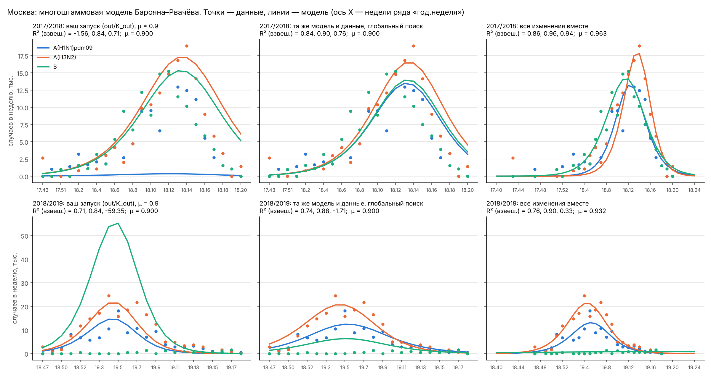

# Калибровка многоштаммовой модели Барояна–Рвачёва

Исследование к вопросу, почему в статье Leonenko V. N. «Herd immunity levels and multi-strain influenza epidemics
in Russia» (RJNAMM, 2021, 36(5):279–291) модель плохо откалибровалась на данные Москвы 2017/18 и 2018/19, и
проверка на шести городах.

## Состав

| Файл | Что это |
|---|---|
| `brmodel.py` | **основная модель:** быстрая (numba) реализация `BRModel` из [RSCF_Uncertainty/BaroyanAgeMultistrain_v2](https://github.com/vnleonenko/RSCF_Uncertainty) — возраст × штамм × история заражения, матрица контактов, сдвиги заражения штаммов |
| `reference_v2/BR_model_new.py` | исходная модель v2 (копия) — эталон для `check_port_v2.py` |
| `msfast.py` | быстрый порт модели и целевой функции `FindModelFit` из `BaroyanMultistrain_v4b` (на ней считалась статья) + варианты постановки |
| `legacy_v4b/` | исходная модель v4b и сохранённые параметры Москвы (`out/K_out_Moscow_*.txt`) — только для воспроизведения цифр статьи |
| `check_port.py`, `check_port_v2.py` | проверки портов против исходного кода |
| `run_experiments.py`, `summarize.py` | эксперименты по городам и сводка |
| `data/` | ряды по штаммам (`incidence_strains_*.csv`, из `generateIncidence.py`), численность населения, матрицы контактов 2 и 4 возрастных групп (из v2) |
| `results/` | `summary.md`, `<город>.json`, рисунки `fits_<город>.png`, `moscow_ladder.png` |

```bash
pip install -e ".[mechanistic,research]"     # numba, scipy, simanneal не нужен
python research/multistrain_calibration/check_port.py
python research/multistrain_calibration/check_port_v2.py
python research/multistrain_calibration/run_experiments.py msk 2017 2018 --out research/multistrain_calibration/results/msk.json
python research/multistrain_calibration/summarize.py
```

## Проверка портов

- `msfast.simulate` совпадает с `BR_model_strains.MakeSimulation` (v4b) до 1e-11; R² из `K_out_Moscow_2017/2018.txt`
  воспроизводятся до третьего знака (−1.558 / 0.839 / 0.706 и 0.706 / 0.839 / −59.3).
- `brmodel.simulate_v2` совпадает с `BR_model_new.BRModel.make_simulation` (v2) без расхождений в режимах `total`,
  `age-group`, `strain`, `strain_age-group`. Исходный v2 несовместим с numpy ≥ 2 (`total_pop_size = sum(rho)` —
  массив формы (1,), присваивание в `x` падает); для сверки он загружается с одной правкой `float(np.sum(rho))`.
- **v2 и v4b в режиме штаммов — одна модель в разных параметризациях.** v4b исключает защищённых из популяции
  (знаменатель (1 − μ)·N), v2 оставляет их в знаменателе N, но не заражает. Пересчёт
  `λ_v2 = λ_v4b · (N − 3) / ((1 − μ)·N + 3)` (`brmodel.lam_v4b_to_v2`) даёт те же траектории (разница пиков 2e-5 — из-за
  трёх начальных заражённых). Поэтому выводы ниже относятся к обеим версиям. Отличия v2 в постановке: сдвиг
  заражения H3N2 на 10 дней задан в коде (`strain_shift = [0, 10, 0]`), выравнивание — по штамму с наибольшим пиком
  модели, σ задаётся в конфиге.

## Постановки

- **статья** — как в v4b: ряд после `dropna()`, общий запас восприимчивых, общий сдвиг по доминирующему штамму,
  μ = 0.9, веса 1.5^(−|t − t_пик|); оптимизатор — дифференциальная эволюция (3 запуска).
- **исходная процедура** — эмуляция `fitOneOutbreak`: 1000 случайных точек (так фактически работает
  `InitValueFinder.move()`) + L-BFGS-B, 3 seed.
- **+ μ оценивается** — μ ∈ [0.8, 0.995] калибруется вместе с остальными параметрами.
- **+ свой сдвиг штамма** — у каждого штамма свой момент старта (своё выравнивание по пику).
- **все изменения** — плюс ряд по календарным неделям (пропуски не удаляются, а исключаются из невязки) и
  отдельный запас восприимчивых у гриппа B.

## Результаты: взвешенный R² (H1N1 / H3N2 / B)

Полная таблица — `results/summary.md`; в скобках — штамм без выраженной волны (пик < 15 % пика сезона).

| Город, сезон | исходная процедура (разброс по запускам) | та же модель, глобальный поиск | все изменения | μ |
|---|---|---|---|---|
| Москва 2017/18 | H1N1 от 0.66 до 0.83, B от 0.54 до 0.74 | 0.84 / 0.90 / 0.76 | 0.86 / 0.96 / 0.94 | 0.960–0.964 |
| Москва 2018/19 | B от −58 до −4 | 0.74 / 0.88 / (−1.7) | 0.76 / 0.90 / (0.33) | 0.927–0.932 |
| СПб 2017/18 | H1N1 от −0.90 до 0.82 | 0.91 / 0.94 / 0.91 | 0.94 / 0.97 / 0.92 | 0.924–0.929 |
| СПб 2018/19 | H3N2 от 0.66 до 0.78 | 0.90 / 0.86 / (−0.42) | 0.92 / 0.96 / (0.54) | 0.854–0.868 |
| Новосибирск 2017/18 | H1N1 от 0.01 до 0.30 | 0.43 / 0.52 / 0.23 | 0.84 / 0.56 / 0.17 | 0.936–0.947 |
| Новосибирск 2018/19 | H3N2 от −0.06 до 0.19 | 0.40 / 0.29 / (−0.24) | 0.45 / 0.47 / (0.39) | 0.878–0.898 |
| Омск 2017/18 | | 0.60 / 0.67 / 0.21 | 0.72 / 0.68 / 0.21 | 0.966–0.969 |
| Омск 2018/19 | | 0.73 / 0.32 / (0.10) | 0.81 / 0.13 / (0.12) | 0.955–0.958 |
| Воронеж 2018/19 | | 0.34 / 0.69 / (−1.16) | 0.72 / 0.88 / (0.10) | 0.971–0.972 |
| Краснодар 2018/19 | B от −183 до −3 | 0.56 / 0.51 / (−0.42) | 0.81 / 0.85 / (−0.06) | 0.992 |



## Выводы

1. **Оптимизатор.** `InitValueFinder.move()` на каждом шаге берёт случайную точку во всём диапазоне, поэтому
   «отжиг» — это 1000 случайных проб без seed, а L-BFGS-B с численными производными почти не сдвигается по
   ступенчатой целевой функции (сдвиг по пику — целое число недель). Разброс R² между запусками огромен
   (СПб 2017/18, H1N1: от −0.90 до 0.82). Глобальный поиск на той же модели и тех же данных даёт для Москвы
   2017/18 0.84 / 0.90 / 0.76 вместо −1.56 / 0.84 / 0.71 в последнем сохранённом запуске.
2. **μ = 0.9 не подходит большинству городов.** Оценённая доля защищённых стабильна между запусками и различается
   по городам и сезонам: 0.85–0.87 (СПб 2018/19), 0.93–0.96 (Москва), 0.95–0.97 (Омск, Воронеж), 0.99 (Краснодар).
   Оценка μ сильнее всего помогает там, где μ далеко от 0.9: Воронеж 2018/19 (H1N1 0.34 → 0.72, H3N2 0.69 → 0.88),
   Краснодар.
3. **α (доли переболевших) не идентифицируются:** запуски с одинаковым R² дают α_H3N2 = 0.10, 0.32 и 0.12 (Москва
   2017/18), параметр a — от 0.19 до 0.50. Сравнивать α с серологией по такой калибровке нельзя; нужны интервалы
   (бутстреп из v2, ABC/MCMC) или ограничения из серологии.
4. **Свой момент старта штамма** помогает, когда штаммы сдвинуты во времени: B в Москве 2017/18 (0.76 → 0.93),
   H1N1 в Новосибирске 2017/18 (0.43 → 0.84). В v2 эта идея реализована вручную (`strain_shift`), здесь — калибруется.
5. **«Неудача» с B 2018/19 — отсутствие волны B**: в Москве за сезон 22 положительные пробы на B (0.16 % населения),
   и взвешенный R² по почти нулевому ряду не информативен. Проверять надо, может ли модель не создавать волну B;
   с общим запасом восприимчивых и общей точкой старта — не может.
6. **Предел качества задают данные.** В Новосибирске и Омске ряды по штаммам скачут от нуля до тысяч случаев от
   недели к неделе (одна положительная проба ≈ сотни случаев при 70–100 протестированных в неделю); в Краснодаре
   пики штаммов — сотни случаев; в Воронеже после `dropna` остаётся 12–14 недель сезона.

## Ограничения

- Ряды по штаммам построены при допущении одинаковой доли гриппа во всех возрастах; по выгрузке ПЦР 2017/18 из
  RSCF_Uncertainty это неверно (доля положительных 0.09 у детей 0–2 лет против 0.21 у взрослых за недели 40–20), см.
  `docs/rscf_uncertainty.md`.
- Метрика — взвешенный R² из исходного кода (вес падает в 1.5 раза на неделю от пика), чтобы сравнение со статьёй
  было прямым.
